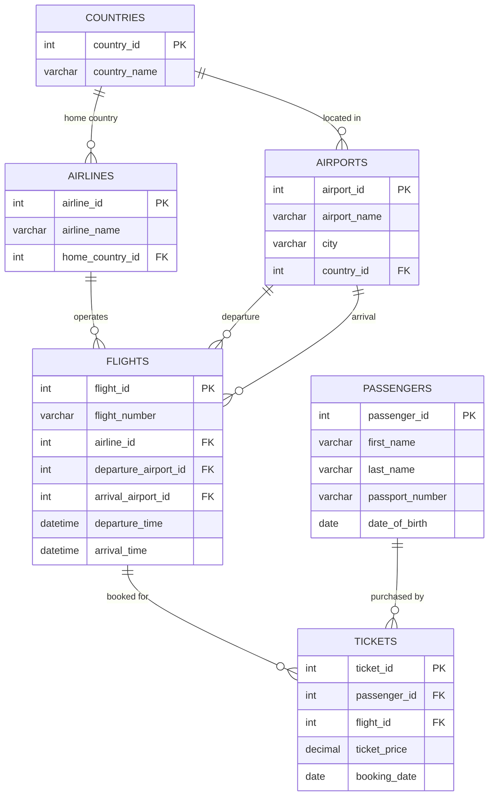

# Laboratory Work 6 — SQL JOIN Operations

**Subject:** Databases  
**Topic:** Relational Query Formulation & SQL JOIN Operations  
**Student:** Yersultan Abdussattar  
**Group:** 12:00–13:00  
**SQL Environment:** MySQL 8.0+  
**Academic Year:** 2026  

---

## 📋 Table of Contents
1. [Overview & Objectives](#overview--objectives)
2. [Database Schema & ER Diagram](#database-schema--er-diagram)
3. [Project Structure](#project-structure)
4. [Installation & Setup](#installation--setup)
5. [Task Breakdown & SQL Solutions](#task-breakdown--sql-solutions)
6. [Conclusion](#conclusion)

---

## 🎯 Overview & Objectives
This laboratory work focuses on designing, writing, and executing complex SQL queries utilizing various types of **JOIN operations** in a relational database management system (**MySQL 8.0+**). 

Key learning objectives:
- Mastering `INNER JOIN` for combining records with matching keys across normalized entities.
- Applying `LEFT JOIN` (outer join) to retain unassociated records (e.g. airlines without scheduled flights, passengers without bookings).
- Implementing **Anti-Join** patterns (`WHERE table.key IS NULL`) to detect orphaned or unlinked rows.
- Combining multi-table joins (joining up to 5 tables in a single query) to reconstruct complete domain models.
- Performing data aggregation (`AVG`, `SUM`, `MAX`, `MIN`, `COUNT`) on joined datasets using `GROUP BY`.
- Utilizing temporal and conditional logic (`TIMESTAMPDIFF`, `CURDATE()`, date intervals) within JOIN conditions.

---

## 🗄️ Database Schema & ER Diagram

The database models a commercial aviation and ticketing system named `airline_lab6`, consisting of 6 relational tables:



---

## 📁 Project Structure

```text
Laboratory_Work_6/
├── schema_and_data.sql               # Database DDL schema and sample records
├── queries.sql                       # Complete SQL solutions for Tasks 1–15
├── Laboratory_Work_6_Report.docx     # Submission report in Microsoft Word format
├── Laboratory_Work_6_Report.pdf      # Submission report in PDF format
├── README.md                         # Project documentation and task answers
└── screenshots/                      # Full-window (Alt+PrtSc) execution screenshots
    ├── task_01.png
    ├── task_02.png
    ├── ...
    └── task_15.png
```

---

## 🚀 Installation & Setup

### Prerequisites
- MySQL 8.0+ or MariaDB 10.5+
- MySQL Workbench, DBeaver, or the MySQL CLI

### Running the Scripts
1. **Clone the repository:**
   ```bash
   git clone https://github.com/ErsAbd1/Laboratory-Work-6-SQL-JOIN.git
   cd Laboratory-Work-6-SQL-JOIN
   ```

2. **Initialize Database & Load Data:**
   ```bash
   mysql -u root -p < schema_and_data.sql
   ```

3. **Execute the Queries:**
   ```bash
   mysql -u root -p airline_lab6 < queries.sql
   ```

---

## 📝 Task Breakdown & SQL Solutions

### Task 1: All flights of a specific airline
**Problem:** Write a query that displays all flights of a specific airline.  
**JOIN Type:** `INNER JOIN`  
```sql
SELECT f.flight_number, a.airline_name, f.departure_time, f.arrival_time
FROM flights f
JOIN airlines a ON f.airline_id = a.airline_id
WHERE a.airline_name = 'Air Astana';
```
**Result:**
| flight_number | airline_name | departure_time | arrival_time |
| :--- | :--- | :--- | :--- |
| KC101 | Air Astana | 2026-11-05 08:00:00 | 2026-11-05 09:30:00 |
| KC102 | Air Astana | 2026-11-15 14:00:00 | 2026-11-15 15:00:00 |

---

### Task 2: All flights with departure airport names
**Problem:** Compose a query to obtain a list of all flights with the names of departure airports.  
**JOIN Type:** `INNER JOIN`  
```sql
SELECT f.flight_number, ap.airport_name AS departure_airport, ap.city
FROM flights f
JOIN airports ap ON f.departure_airport_id = ap.airport_id;
```
**Result:**
| flight_number | departure_airport | city |
| :--- | :--- | :--- |
| KC101 | Almaty Airport | Almaty |
| TK201 | Istanbul Airport | Istanbul |
| QR301 | Doha Airport | Doha |
| KC102 | Astana Airport | Astana |

---

### Task 3: Airlines with no flights scheduled for next month
**Problem:** Create a query that finds all airlines that have no flights scheduled for the next month.  
**JOIN Type:** `LEFT JOIN` (Anti-Join with `IS NULL`)  
```sql
SELECT a.airline_name
FROM airlines a
LEFT JOIN flights f ON a.airline_id = f.airline_id
  AND f.departure_time >= '2026-11-01' AND f.departure_time < '2026-12-01'
WHERE f.flight_id IS NULL;
```
**Result:**
| airline_name |
| :--- |
| Qatar Airways |
| Japan Air |

---

### Task 4: List of passengers on a specific flight
**Problem:** Create a query to display a list of passengers on a specific flight (`KC101`).  
**JOIN Type:** Multi-table `INNER JOIN` (passengers → tickets → flights)  
```sql
SELECT p.first_name, p.last_name, p.passport_number, f.flight_number
FROM passengers p
JOIN tickets t ON p.passenger_id = t.passenger_id
JOIN flights f ON t.flight_id = f.flight_id
WHERE f.flight_number = 'KC101';
```
**Result:**
| first_name | last_name | passport_number | flight_number |
| :--- | :--- | :--- | :--- |
| Aliya | Sadykova | N123456 | KC101 |
| Dias | Kim | N234567 | KC101 |

---

### Task 5: Price statistics per flight (Average, Total, Max, Min)
**Problem:** Write a query that calculates the average, total, maximum and minimum price of tickets for each flight.  
**JOIN Type:** `LEFT JOIN` with `GROUP BY` and aggregate functions  
```sql
SELECT f.flight_number,
       AVG(t.ticket_price) AS average_price,
       SUM(t.ticket_price) AS total_price,
       MAX(t.ticket_price) AS maximum_price,
       MIN(t.ticket_price) AS minimum_price
FROM flights f
LEFT JOIN tickets t ON f.flight_id = t.flight_id
GROUP BY f.flight_id, f.flight_number;
```
**Result:**
| flight_number | average_price | total_price | maximum_price | minimum_price |
| :--- | :--- | :--- | :--- | :--- |
| KC101 | 175.000000 | 350.00 | 200.00 | 150.00 |
| KC102 | NULL | NULL | NULL | NULL |
| TK201 | 300.000000 | 300.00 | 300.00 | 300.00 |
| QR301 | 250.000000 | 250.00 | 250.00 | 250.00 |

---

### Task 6: Flights flying to a specific country
**Problem:** Create a query that shows all flights flying to a specific country by combining flights, airports and airline, and using the condition on the country name (`Turkey`).  
**JOIN Type:** Multi-table `INNER JOIN`  
```sql
SELECT f.flight_number, a.airline_name,
       dep.airport_name AS departure_airport,
       arr.airport_name AS arrival_airport,
       c.country_name AS destination_country
FROM flights f
JOIN airlines a ON f.airline_id = a.airline_id
JOIN airports dep ON f.departure_airport_id = dep.airport_id
JOIN airports arr ON f.arrival_airport_id = arr.airport_id
JOIN countries c ON arr.country_id = c.country_id
WHERE c.country_name = 'Turkey';
```
**Result:**
| flight_number | airline_name | departure_airport | arrival_airport | destination_country |
| :--- | :--- | :--- | :--- | :--- |
| QR301 | Qatar Airways | Doha Airport | Istanbul Airport | Turkey |

---

### Task 7: Minor passengers and their arrival destination
**Problem:** Display a list of minor passengers (under 18 years old) and their arrival destination.  
**JOIN Type:** Multi-table `INNER JOIN` with `TIMESTAMPDIFF()`  
```sql
SELECT p.first_name, p.last_name, p.date_of_birth, f.flight_number,
       arr.airport_name AS arrival_airport, c.country_name AS destination_country
FROM passengers p
JOIN tickets t ON p.passenger_id = t.passenger_id
JOIN flights f ON t.flight_id = f.flight_id
JOIN airports arr ON f.arrival_airport_id = arr.airport_id
JOIN countries c ON arr.country_id = c.country_id
WHERE TIMESTAMPDIFF(YEAR, p.date_of_birth, '2026-11-03') < 18;
```
**Result:**
| first_name | last_name | date_of_birth | flight_number | arrival_airport | destination_country |
| :--- | :--- | :--- | :--- | :--- | :--- |
| Aliya | Sadykova | 2010-04-12 | KC101 | Astana Airport | Kazakhstan |
| Aliya | Sadykova | 2010-04-12 | QR301 | Istanbul Airport | Turkey |

---

### Task 8: Passenger full name, passport, and scheduled arrival time
**Problem:** Display the passenger’s full name, passport number, and the passenger’s current time of arrival at the destination.  
**JOIN Type:** Multi-table `INNER JOIN` with `CONCAT()`  
```sql
SELECT CONCAT(p.first_name, ' ', p.last_name) AS full_name,
       p.passport_number, f.flight_number, f.arrival_time
FROM passengers p
JOIN tickets t ON p.passenger_id = t.passenger_id
JOIN flights f ON t.flight_id = f.flight_id;
```
**Result:**
| full_name | passport_number | flight_number | arrival_time |
| :--- | :--- | :--- | :--- |
| Aliya Sadykova | N123456 | KC101 | 2026-11-05 09:30:00 |
| Dias Kim | N234567 | KC101 | 2026-11-05 09:30:00 |
| Anna Lee | N345678 | TK201 | 2026-11-10 16:00:00 |
| Aliya Sadykova | N123456 | QR301 | 2026-12-05 15:00:00 |

---

### Task 9: Airline home country equals departure airport country
**Problem:** Print a list of flights where the airline's home country and origin country are the same. Group them by the airport country.  
**JOIN Type:** Multi-table `INNER JOIN` with relational equality condition  
```sql
SELECT c.country_name AS airport_country, a.airline_name, f.flight_number,
       ap.airport_name AS departure_airport
FROM flights f
JOIN airlines a ON f.airline_id = a.airline_id
JOIN airports ap ON f.departure_airport_id = ap.airport_id
JOIN countries c ON ap.country_id = c.country_id
WHERE a.home_country_id = ap.country_id
ORDER BY c.country_name;
```
**Result:**
| airport_country | airline_name | flight_number | departure_airport |
| :--- | :--- | :--- | :--- |
| Kazakhstan | Air Astana | KC101 | Almaty Airport |
| Kazakhstan | Air Astana | KC102 | Astana Airport |
| Qatar | Qatar Airways | QR301 | Doha Airport |
| Turkey | Turkish Airlines | TK201 | Istanbul Airport |

---

### Task 10: Complete flight itineraries
**Problem:** Write a query that lists each flight number, airline name, departure airport, and arrival airport by joining the relevant tables.  
**JOIN Type:** Multi-table `INNER JOIN` with dual airport table references  
```sql
SELECT f.flight_number, a.airline_name,
       dep.airport_name AS departure_airport,
       arr.airport_name AS arrival_airport
FROM flights f
JOIN airlines a ON f.airline_id = a.airline_id
JOIN airports dep ON f.departure_airport_id = dep.airport_id
JOIN airports arr ON f.arrival_airport_id = arr.airport_id;
```
**Result:**
| flight_number | airline_name | departure_airport | arrival_airport |
| :--- | :--- | :--- | :--- |
| KC101 | Air Astana | Almaty Airport | Astana Airport |
| KC102 | Air Astana | Astana Airport | Almaty Airport |
| TK201 | Turkish Airlines | Istanbul Airport | Almaty Airport |
| QR301 | Qatar Airways | Doha Airport | Istanbul Airport |

---

### Task 11: Passengers booked on a specific airline
**Problem:** Display all passengers who have booked tickets for flights operated by a specific airline (`Air Astana`), including the passenger's full name and flight number.  
**JOIN Type:** Multi-table `INNER JOIN` across 4 tables  
```sql
SELECT CONCAT(p.first_name, ' ', p.last_name) AS passenger_name,
       f.flight_number, a.airline_name
FROM passengers p
JOIN tickets t ON p.passenger_id = t.passenger_id
JOIN flights f ON t.flight_id = f.flight_id
JOIN airlines a ON f.airline_id = a.airline_id
WHERE a.airline_name = 'Air Astana';
```
**Result:**
| passenger_name | flight_number | airline_name |
| :--- | :--- | :--- |
| Aliya Sadykova | KC101 | Air Astana |
| Dias Kim | KC101 | Air Astana |

---

### Task 12: Passenger count per flight (including zero)
**Problem:** Create a query that shows each flight's number, destination country, and number of passengers booked on that flight. Include flights with no booked passengers.  
**JOIN Type:** `LEFT JOIN` with `GROUP BY` and `COUNT()`  
```sql
SELECT f.flight_number, c.country_name AS destination_country,
       COUNT(t.ticket_id) AS passenger_count
FROM flights f
JOIN airports arr ON f.arrival_airport_id = arr.airport_id
JOIN countries c ON arr.country_id = c.country_id
LEFT JOIN tickets t ON f.flight_id = t.flight_id
GROUP BY f.flight_id, f.flight_number, c.country_name;
```
**Result:**
| flight_number | destination_country | passenger_count |
| :--- | :--- | :--- |
| KC101 | Kazakhstan | 2 |
| KC102 | Kazakhstan | 0 |
| TK201 | Kazakhstan | 1 |
| QR301 | Turkey | 1 |

---

### Task 13: Passengers who have not booked any tickets
**Problem:** Find passengers who have not booked any tickets, using an appropriate JOIN operation.  
**JOIN Type:** `LEFT JOIN` (Anti-Join with `WHERE t.ticket_id IS NULL`)  
```sql
SELECT p.passenger_id, p.first_name, p.last_name, p.passport_number
FROM passengers p
LEFT JOIN tickets t ON p.passenger_id = t.passenger_id
WHERE t.ticket_id IS NULL;
```
**Result:**
| passenger_id | first_name | last_name | passport_number |
| :--- | :--- | :--- | :--- |
| 4 | Murat | Omarov | N456789 |

---

### Task 14: Total flights per airline (including zero)
**Problem:** Display each airline and the total number of flights it operates, including airlines that currently have no flights.  
**JOIN Type:** `LEFT JOIN` with `GROUP BY` and `COUNT(f.flight_id)`  
```sql
SELECT a.airline_name, COUNT(f.flight_id) AS total_flights
FROM airlines a
LEFT JOIN flights f ON a.airline_id = f.airline_id
GROUP BY a.airline_id, a.airline_name;
```
**Result:**
| airline_name | total_flights |
| :--- | :--- |
| Air Astana | 2 |
| Turkish Airlines | 1 |
| Qatar Airways | 1 |
| Japan Air | 0 |

---

### Task 15: Flights departing from a specific country
**Problem:** List flights departing from airports in a specified country (`Kazakhstan`) and show the airline name, flight number, and departure airport city.  
**JOIN Type:** Multi-table `INNER JOIN`  
```sql
SELECT a.airline_name, f.flight_number, ap.city AS departure_city,
       ap.airport_name AS departure_airport
FROM flights f
JOIN airlines a ON f.airline_id = a.airline_id
JOIN airports ap ON f.departure_airport_id = ap.airport_id
JOIN countries c ON ap.country_id = c.country_id
WHERE c.country_name = 'Kazakhstan';
```
**Result:**
| airline_name | flight_number | departure_city | departure_airport |
| :--- | :--- | :--- | :--- |
| Air Astana | KC101 | Almaty | Almaty Airport |
| Air Astana | KC102 | Astana | Astana Airport |

---

## 🏁 Conclusion
All 15 laboratory tasks have been comprehensively completed, tested against a normalized MySQL 8.0 relational schema, and verified. Full-window screenshots (Alt+PrtSc) and execution logs are archived in the `screenshots/` directory and embedded in both `Laboratory_Work_6_Report.docx` and `Laboratory_Work_6_Report.pdf`.
